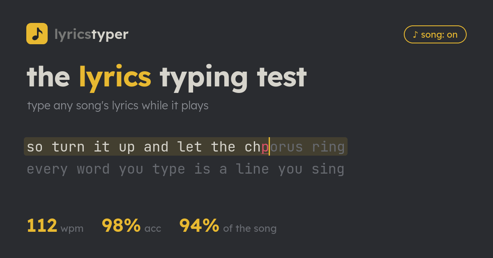
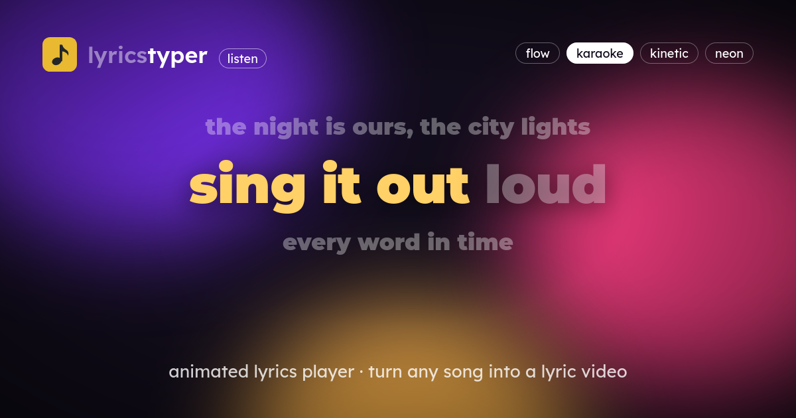
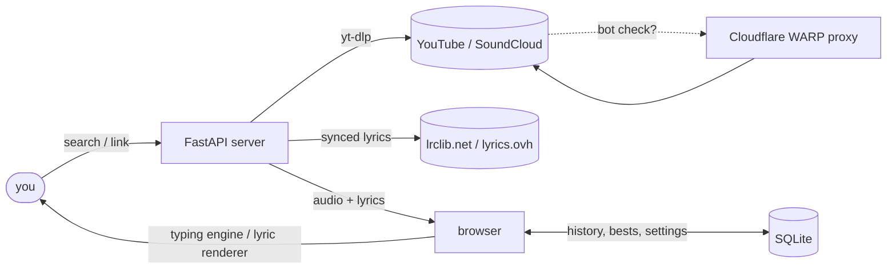

<div align="center">


# lyricstyper

**Type the lyrics. Feel the song.**

A typing test where the text is the lyrics of the song you're listening to,<br/>
plus a player that turns any song into an animated lyric video.

[](https://song.vux06.space)
[](https://song.vux06.space/listen.html)


</div>

---

## 🌐 Live

| | |
| --- | --- |
| ⌨️ **Typing test** | **<https://song.vux06.space>** |
| 🎧 **Animated lyrics player** | **<https://song.vux06.space/listen.html>** |
| 🔁 Same app on port 2222 | <https://song.vux06.space:2222> |
| 🔒 Privacy policy | <https://song.vux06.space/privacy.html> |

Sign in with Google to search and play songs. Your history, personal bests and settings follow you to every device.

---

## ⌨️ The typing test



Pick a song, press play, and type along. The line being sung lights up, and a small indicator tells you whether you're **behind** or **ahead** of the singer.

- 🔎 **Any song**: search YouTube or SoundCloud, or paste a link
- 📝 **Lyrics found automatically**: time-synced LRC from [lrclib.net](https://lrclib.net), plain lyrics from lyrics.ovh as a fallback. You can pick another match, search yourself or paste your own (plain text or `.lrc`)
- 🔊 **song: on / off**: type in sync with the music, or turn it off for a silent lyrics test
- 📊 **Real stats**: wpm, raw wpm, accuracy, consistency, correct / incorrect / extra / missed characters, how much of the song you typed and heard, and a wpm / raw / errors chart
- 🏆 **Personal best for every song** and a full history with "play again"
- 🎛️ **Your rules**: ignore case or punctuation, simplify accents and quotes, drop `(ad-libs)` and `[tags]`, keep line breaks, playback speed 0.5×–1.25×, lyrics offset
- 🎨 **5 themes**: midnight, paper, forest, rose and ocean

## 🎧 The lyric video player



Don't know the words yet? Watch them first. Any song plays as a full-screen lyric video.

| style | what it does |
| --- | --- |
| 🌊 **flow** | scrolling lyrics. Click any line to jump to it |
| 🎤 **karaoke** | each word fills with colour as it's sung |
| 💥 **kinetic** | bold uppercase words pop in on the beat |
| ⌨️ **typewriter** | letters type themselves out with a blinking cursor |
| 💡 **neon** | glowing words that flicker on |

The background is the blurred cover art plus drifting colour blobs taken from it, with film grain and a vignette. A **beat pulse** follows the bass, so the background and text move with the music. There's also a title card during the intro, animated dots during instrumental breaks, 7 fonts, loop, speed and offset controls, and controls that hide while the song plays.

<sub>Keys: <kbd>space</kbd> play/pause · <kbd>←</kbd> <kbd>→</kbd> ±5 s · <kbd>↑</kbd> <kbd>↓</kbd> previous/next line · <kbd>1</kbd>–<kbd>5</kbd> style · <kbd>f</kbd> fullscreen</sub>

---

## ⚙️ How it works



- **Word timing**: LRC lyrics only have a time per line, so each word's time is estimated by spreading the line over its duration, weighted by length. Held notes and long breaks are capped so they don't stretch the words. If a song feels early or late, use **lyrics offset**.
- **WPM** counts 5 characters as one word. By default it uses *active* typing time, so instrumental breaks don't lower your score. You can switch to total time in settings.
- **Accounts** use the Google Identity Services button: the ID token is checked with Google, then a 30-day session cookie is set. History, settings and recent tracks are stored per user in SQLite.

---

## 🚀 Run it yourself

```bash
git clone https://github.com/vux06/lyricstyper.git
cd lyricstyper
./run.sh                 # → http://127.0.0.1:8000   (PORT=9000 ./run.sh to change)
```

`run.sh` creates a `.venv` on first run and installs `requirements.txt`.

**Requirements**: Python 3.10+, `ffmpeg`, and a JS runtime (`deno` or `node`) that yt-dlp needs for YouTube.

Without `GOOGLE_CLIENT_ID` the app runs **open**: no login, and everything stays in your browser's localStorage. That's ideal for local use.

| env var | what it does |
| --- | --- |
| `GOOGLE_CLIENT_ID` | turns on Google sign-in. Use a *Web application* OAuth client whose JavaScript origin is your site (no redirect URI needed) |
| `DB_PATH` | SQLite file (default `data/lyricstyper.db`) |
| `YTDLP_PROXY` | proxy used **only after** YouTube blocks a request, e.g. `socks5://127.0.0.1:40000` (Cloudflare WARP in proxy mode) |
| `YTDLP_COOKIES` | Netscape `cookies.txt` for YouTube (default `cache/youtube-cookies.txt`) |

> 💡 If YouTube downloads start failing, update yt-dlp: `.venv/bin/pip install -U "yt-dlp[default]"`

<details>
<summary><b>☁️ How the live site is deployed</b></summary>

<br/>

- **EC2 (Ubuntu)**: a `systemd` unit runs uvicorn on `127.0.0.1:8200`, with its environment in `/etc/lyricstyper.env`
- **Caddy** handles HTTPS for `song.vux06.space` on ports **443 and 2222** and proxies to the app
- **Cloudflare WARP** runs in proxy mode (SOCKS5 on `127.0.0.1:40000`). Only yt-dlp uses it, and only after YouTube says *"Sign in to confirm you're not a bot"*, so SSH and other sites are unaffected. If that fails too, the server looks for the artist's own SoundCloud upload
- **SEO**: titles, descriptions, canonical URLs, Open Graph cards, JSON-LD, `robots.txt` and `sitemap.xml`. The site is verified in Google Search Console

</details>

---

## 🗂️ Project layout

```
server.py            FastAPI: search, audio download/stream, lyrics lookup, thumbnails
auth.py              Google sign-in, sessions, per-user data (SQLite)
run.sh               one-command local start
static/
├── index.html       typing test page      app.js       typing engine, scoring, history, settings
├── listen.html      lyric video page      listen.js    lyric timing, 5 renderers, beat detection, palette
├── common.js        shared: api, search, track loading, LRC parsing, lyrics picker, account sync
├── style.css        themes + shared UI    listen.css   lyric-video visuals
├── login.html       sign-in page          privacy.html privacy policy
└── robots.txt · sitemap.xml · og images · icons
```

## ⌨️ Typing test keys

| key | action |
| --- | --- |
| <kbd>space</kbd> / <kbd>enter</kbd> | next word |
| <kbd>backspace</kbd> / <kbd>ctrl</kbd>+<kbd>backspace</kbd> | delete letter / word |
| <kbd>esc</kbd> | stop and show results |
| <kbd>tab</kbd> | restart (on results: retry) |
| <kbd>ctrl</kbd>+<kbd>p</kbd> | pause / resume |

---

<div align="center">

**Built for people who type faster when the music's on.** 🎶

Audio via [yt-dlp](https://github.com/yt-dlp/yt-dlp) · lyrics via [lrclib.net](https://lrclib.net) and lyrics.ovh · for personal typing practice

</div>
